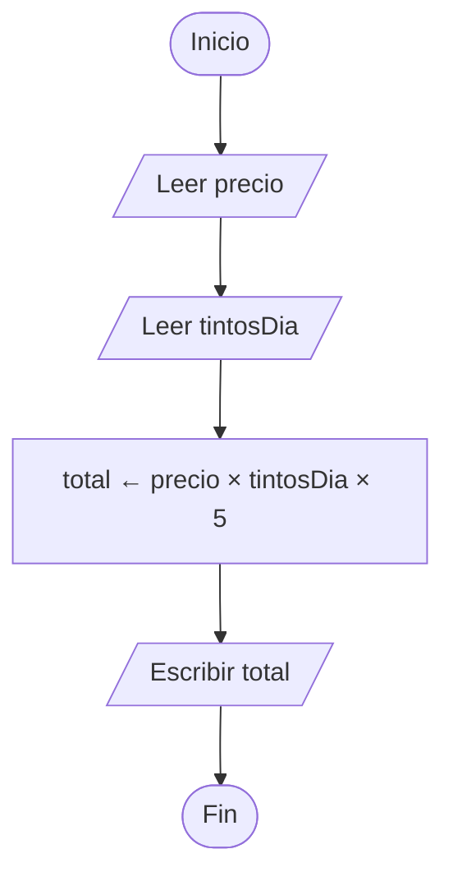
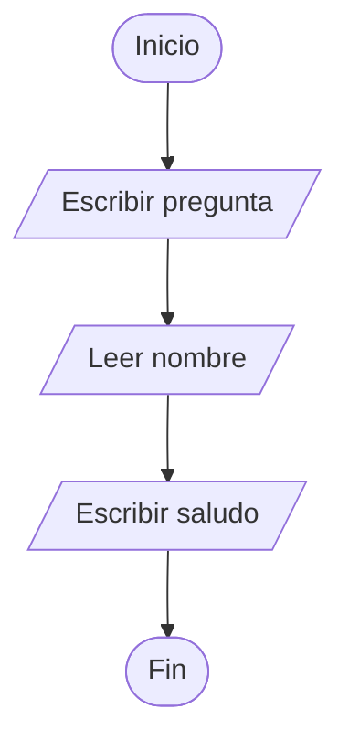
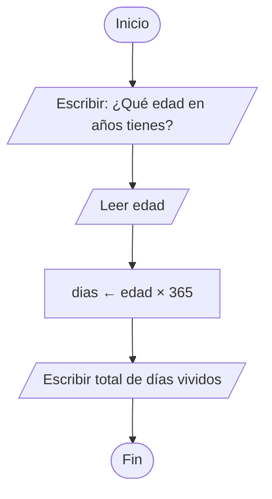
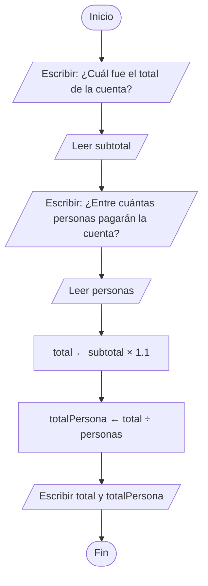

# Diagrama de flujo: Cálculo del total

## Diagrama de flujo gastoTinto




# Diagrama de flujo: Saludo personalizado



# Diagrama de flujo: Calcular edad en días



# Diagrama de flujo: Cálculo de cuenta con propina



# Diagrama de flujo: Promedio de notas

```mermaid
flowchart TD
    A([Inicio]) --> B[/Escribir: Ingrese la primera nota/]
    B --> C[/Leer nota1/]
    C --> D[/Escribir: Ingrese la segunda nota/]
    D --> E[/Leer nota2/]
    E --> F[/Escribir: Ingrese la tercera nota/]
    F --> G[/Leer nota3/]
    G --> H[promedio ← (nota1 + nota2 + nota3) ÷ 3]
    H --> I[/Escribir promedio/]
    I --> J([Fin])
```