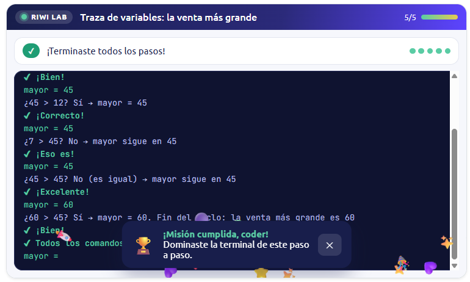
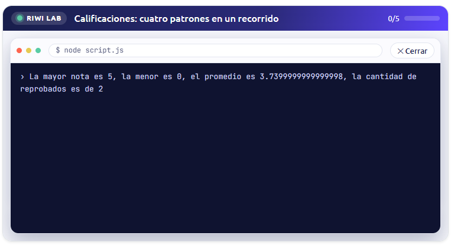
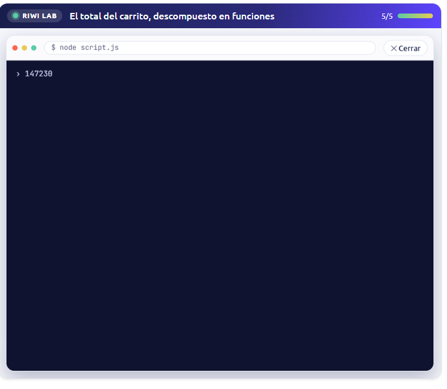

```
// Devuelve { promedio, mayor, menor, reprobados }

function resumenNotas(notas) {
    if (notas.length === 0) {
        return {
            promedio: 0,
            mayor: 0,
            menor: 0,
            reprobados: 0
        };
    }

    let mayor = notas[0];
    let menor = notas[0];
    let prom = 0;
    let reprobados = 0;

    notas.forEach((nota) => {
        if (nota > mayor) {
            mayor = nota;
        }

        if (nota < menor) {
            menor = nota;
        }

        if (nota < 3) {
            reprobados++;
        }

        prom += nota;
    });

    prom = prom / notas.length;

    return {
        promedio: prom,
        mayor: mayor,
        menor: menor,
        reprobados: reprobados
    };
}

console.log(resumenNotas([4.5, 2.8, 3.9, 2.5, 5.0]));
console.log(resumenNotas([]));

```




```
function calcularSubtotal(items) {
    let subtotal = 0;

    items.forEach((item) => {
        subtotal += item.precio * item.cantidad;
    });

    return subtotal;
}

function aplicarCupon(subtotal, cupon) {
    if (cupon === "RIWI10") {
        return subtotal * 0.90;
    }

    return subtotal;
}

function calcularImpuesto(valor) {
    return valor * 0.19;
}

function calcularEnvio(subtotal) {
    if (subtotal > 150000) {
        return 0;
    }

    return 8000;
}

function calcularTotal(items, cupon) {
    let subtotal = calcularSubtotal(items);
    let valorDescuento = aplicarCupon(subtotal, cupon);
    let impuesto = calcularImpuesto(valorDescuento);
    let envio = calcularEnvio(subtotal);

    return valorDescuento + impuesto + envio;
}

const carrito = [
    { precio: 50000, cantidad: 2 },
    { precio: 30000, cantidad: 1 }
];

console.log(calcularTotal(carrito, "RIWI10"));
```

